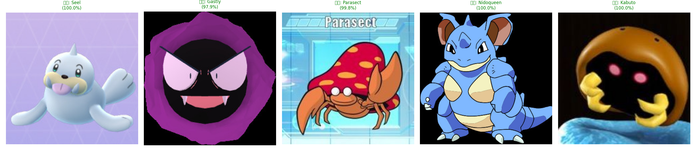

<div align="center">

# 🎮 MyPocket
### Transfer Learning-Based Pokémon Image Classification

**PyTorch 기반 이미지 분류 모델 비교 및 전이학습 실험**

사전학습 여부, 파인튜닝 범위, CNN Backbone에 따른 분류 성능을 비교하고 Streamlit 추론 데모를 구현한 프로젝트입니다.


</div>

---

## 01. Project Overview

**MyPocket**은 포켓몬 이미지를 분류하는 CNN 프로젝트로, 모델 아키텍처·사전학습 여부·파인튜닝 범위가 정확도에 미치는 영향을 비교했습니다. 학습 결과를 Streamlit 추론 화면에서도 확인할 수 있도록 구성했습니다.

### 구현·실험 범위 (공개 저장소 기준)

| 영역 | 내용 | 근거 |
|:--|:--|:--|
| 모델 비교 | ResNet18, EfficientNet-B0, MobileNetV2의 학습 전략 5가지 비교 | 아래 실험 결과표 |
| 성능 평가 | Accuracy, Precision, Recall, 학습 곡선, 예측 이미지 비교 | `learning_curve.png`, `prediction_examples.png` |
| 추론 데모 | ResNet18 기반 이미지 업로드 및 Top-5 예측 확률 시각화 | [`app.py`](app.py) |

> **담당 범위 안내:** 위는 저장소에서 확인되는 구현·실험 범위입니다. 개인/팀 과제 여부와 본인 담당 범위는 아직 공개 자료만으로 확인할 수 없어 임의로 기재하지 않았습니다.

---

## 02. Models & Experiment Setup

| 실험 | Backbone | Fine-tuning | Pretrained | Accuracy | Precision | Recall |
|:---:|:---|:---|:---:|---:|---:|---:|
| Exp 1 | ResNet18 | 마지막 분류층만 | ✅ | 79.47% | 80.79% | 79.80% |
| **Exp 2** | **ResNet18** | **전체 파인튜닝** | ✅ | **93.84%** | **94.31%** | **93.96%** |
| Exp 3 | ResNet18 | 전체 학습 | ❌ | 57.84% | 61.61% | 59.11% |
| Exp 4 | EfficientNet-B0 | 마지막 분류층만 | ✅ | 78.67% | 80.28% | 78.46% |
| Exp 5 | MobileNetV2 | 전체 파인튜닝 | ✅ | 92.52% | 92.88% | 92.94% |

**Best recorded model:** Pretrained ResNet18 + Full Fine-tuning (Accuracy **93.84%**)

### Research Notes

- 동일한 ResNet18 구조에서 사전학습 여부에 따른 정확도 차이는 **36.00%p**입니다 (Exp 2 vs. Exp 3).
- 사전학습된 ResNet18에서 전체 파인튜닝은 마지막 분류층 학습보다 **14.37%p** 높은 정확도를 기록했습니다 (Exp 2 vs. Exp 1).
- 전체 파인튜닝을 수행한 ResNet18과 MobileNetV2의 정확도 차이는 **1.32%p**입니다 (Exp 2 vs. Exp 5).
- 이 결과는 **기록된 실험 조건 내의 비교**입니다. 데이터셋 분할, 학습 epoch, random seed, 정규화·증강 세부 설정과 반복 실험 횟수가 공개 저장소에 없어 일반적인 우열을 입증하지는 않습니다.

### Experiment Conditions: 확인 상태

| 항목 | 확인된 내용 | 추가 기록 필요 |
|:--|:--|:--|
| Backbone / 전이학습 전략 | 위 5개 설정과 결과표 | 가중치 초기화 및 모델별 학습 명령 |
| 추론 전처리 | `224 × 224` Resize → Tensor → ImageNet 정규화 (공개 `app.py` 기준) | 학습 때 동일하게 적용했는지 검증 |
| 클래스 | [`class_name.json`](class_name.json) 파일에 포켓몬 클래스 목록 | 실제 학습/평가 클래스 수와 매핑 순서 검증 |
| 평가 지표 | Accuracy·Precision·Recall | 평가 데이터 수·split·평균 방식 |
| 재현성 | 기록된 학습 곡선·예측 예시 보유 | 학습 스크립트와 checkpoint 제공 여부 |

> **중요:** `app.py`의 추론 전처리와 모델 로딩 설정을 근거로 학습 당시의 모든 하이퍼파라미터를 추정하지 않았습니다. 실험 결과는 기존 README의 기록을 보존했습니다.

---

## 03. Training Visualization

### Learning Curve


### Prediction Examples



---

## 04. Interactive Demo

Streamlit 앱에서 이미지를 업로드하면 ResNet18 모델이 Top-1 클래스와 Top-5 예측 확률을 표시합니다.

<div align="center">


</div>

---

## 05. Tech Stack

| Category | Technologies |
|:--|:--|
| Language | Python |
| Deep Learning | PyTorch, Torchvision |
| CNN Models | ResNet18, EfficientNet-B0, MobileNetV2 |
| Evaluation | Accuracy, Precision, Recall |
| Demo | Streamlit, PIL |

---

## 06. How to Run · 실제 파일 경로 기준

```bash
pip install streamlit torch torchvision pillow
```

현재 `app.py`는 **루트 디렉터리의 파일이 아닌** 아래 두 경로를 불러오도록 작성되어 있습니다.

```text
MyPocket/
├── README.md
├── app.py
├── class_name.json             # 현재 공개되어 있는 파일
├── models/                     # 현재 공개 저장소에 없음
│   ├── class_names.json        # class_name.json 복사본 필요
│   └── exp2_resnet18_fullft.pth  # 별도 학습 가중치 필요
├── learning_curve.png
└── prediction_examples.png
```

가중치 파일을 **직접 준비한 뒤**, 프로젝트 루트에서 다음 명령을 실행합니다.

```bash
mkdir -p models
cp class_name.json models/class_names.json
streamlit run app.py
```

Windows PowerShell에서 클래스 파일 복사:

```powershell
New-Item -ItemType Directory -Force models
Copy-Item class_name.json models/class_names.json
streamlit run app.py
```

> **주의:** 학습된 `models/exp2_resnet18_fullft.pth`는 현재 공개 저장소에 없으므로 `pip install`만으로 데모 실행이 되지 않습니다. 체크포인트를 준비하지 않았다면 공개된 학습 그래프와 GUI 스크린샷을 참고해 주세요. 모델 체크포인트와 클래스 순서가 일치해야 합니다.

---

## 07. Key Takeaways & Limitations

이 프로젝트에서는 사전학습 가중치의 활용 여부와 파인튜닝 범위가 이미지 분류 결과에 미치는 영향을 정량적으로 비교했습니다. 다양한 CNN 모델의 결과를 동일한 지표로 정리하고, 학습된 모델을 사용자 인터페이스로 연결했습니다.

추가로 보완할 항목은 **학습 스크립트·데이터 분할 정보·반복 실험·모델 가중치의 공개 여부**입니다. 공개된 평가 숫자와 학습 코드를 함께 제공하면 실험 재현성이 더 높아집니다.

<div align="center">

**MyPocket — Exploring Image Classification through Transfer Learning**

</div>
