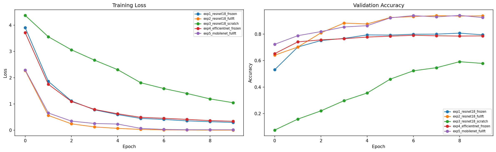

<div align="center">

# 🎮 MyPocket
### Transfer Learning-Based Pokémon Image Classification

**PyTorch 기반 이미지 분류 모델 비교 및 전이학습 실험**

사전학습 여부, Fine-tuning 범위, CNN Backbone에 따른  
이미지 분류 성능을 비교하고 Streamlit 기반 추론 데모를 구현한 프로젝트입니다.


</div>

---

## 01. Project Overview

**MyPocket**은 포켓몬 이미지를 입력받아 해당 캐릭터를 분류하는 딥러닝 프로젝트입니다.

단순히 이미지 분류 모델을 구현하는 것을 넘어, 동일한 분류 문제에서 **사전학습 가중치의 사용 여부, 파인튜닝 범위, 모델 아키텍처**에 따른 성능 차이를 비교하는 데 중점을 두었습니다.

### Objectives

- PyTorch 기반 CNN 이미지 분류 모델 구현
- 사전학습 모델과 비사전학습 모델의 성능 비교
- Feature Extraction과 Full Fine-tuning 전략 비교
- ResNet18, EfficientNet-B0, MobileNetV2 모델 실험
- Accuracy, Precision, Recall을 활용한 정량적 평가
- Streamlit 기반 이미지 분류 데모 구현

---

## 02. Models & Experiment Setup

세 가지 CNN 아키텍처를 활용하여 총 5가지 실험을 구성했습니다.

| Backbone | Experiment Strategy |
|:---|:---|
| **ResNet18** | 사전학습 + 마지막 분류층 학습 |
| **ResNet18** | 사전학습 + 전체 파인튜닝 |
| **ResNet18** | 사전학습 없이 전체 학습 |
| **EfficientNet-B0** | 사전학습 + 마지막 분류층 학습 |
| **MobileNetV2** | 사전학습 + 전체 파인튜닝 |

### Experimental Focus

**① Effect of Pretraining**

사전학습된 가중치를 사용하는 경우와 처음부터 학습하는 경우를 비교하여 전이학습의 효과를 확인했습니다.

**② Fine-tuning Strategy**

마지막 분류층만 학습하는 방식과 전체 네트워크를 파인튜닝하는 방식의 성능을 비교했습니다.

**③ Backbone Comparison**

서로 다른 CNN 아키텍처를 활용하여 각 실험 설정에서 나타나는 분류 성능 차이를 분석했습니다.

---

## 03. Experimental Results

### Performance Comparison

| Exp. | Backbone | Fine-tuning | Pretrained | Accuracy | Precision | Recall |
|:---:|:---|:---|:---:|---:|---:|---:|
| Exp 1 | ResNet18 | Classifier Only | ✅ | 79.47% | 80.79% | 79.80% |
| **Exp 2** | **ResNet18** | **Full Fine-tuning** | ✅ | **93.84%** | **94.31%** | **93.96%** |
| Exp 3 | ResNet18 | Full Training | ❌ | 57.84% | 61.61% | 59.11% |
| Exp 4 | EfficientNet-B0 | Classifier Only | ✅ | 78.67% | 80.28% | 78.46% |
| Exp 5 | MobileNetV2 | Full Fine-tuning | ✅ | 92.52% | 92.88% | 92.94% |

> 본 프로젝트에 기록된 실험 결과 기준으로, 사전학습된 ResNet18의 전체 파인튜닝 방식(Exp 2)이 가장 높은 분류 정확도를 기록했습니다.

### Best Model Performance

<div align="center">

| Metric | Score |
|:---:|:---:|
| **Accuracy** | **93.84%** |
| Precision | 94.31% |
| Recall | 93.96% |
| Architecture | ResNet18 |
| Strategy | Pretrained + Full Fine-tuning |

</div>

---

## 04. Results & Analysis

### 4.1 Impact of Transfer Learning

동일한 ResNet18 구조에서 사전학습 가중치의 사용 여부에 따른 성능을 비교했습니다.

- Pretrained + Full Fine-tuning: **93.84%**
- Without Pretraining + Full Training: **57.84%**

사전학습된 가중치를 활용한 경우 정확도가 **36.00%p 높게** 나타났습니다.

이를 통해 해당 데이터셋과 실험 조건에서 사전학습된 특징 표현을 활용하는 것이 이미지 분류 성능 향상에 효과적임을 확인했습니다.

### 4.2 Effect of Fine-tuning Strategy

사전학습된 ResNet18을 대상으로 학습 범위에 따른 차이를 비교했습니다.

- Classifier Only: **79.47%**
- Full Fine-tuning: **93.84%**

전체 네트워크를 파인튜닝한 경우 정확도가 **14.37%p 높게** 나타났습니다.

이는 기존 모델의 분류층만 변경하는 방식보다, 이미지 분류 과제에 맞게 특징 추출 계층까지 조정하는 전략이 본 실험에서 더 효과적이었음을 보여줍니다.

### 4.3 Comparison of CNN Architectures

전체 파인튜닝을 수행한 사전학습 모델의 결과를 비교했습니다.

- ResNet18: **93.84%**
- MobileNetV2: **92.52%**

두 모델 모두 90% 이상의 분류 정확도를 기록했으며, ResNet18이 1.32%p 높은 정확도를 보였습니다.

다만 모델의 연산량, 추론 속도 및 메모리 사용량은 별도로 측정하지 않았으므로 분류 성능 이외의 효율성을 직접 비교하기는 어렵습니다.

---

## 05. Training Visualization

### Learning Curve

모델 학습 과정에서 기록한 학습 곡선을 시각화했습니다.

<div align="center">



</div>

### Prediction Examples

이미지 입력에 따른 모델의 분류 결과를 확인했습니다.

<div align="center">


</div>

---

## 06. Interactive Demo

학습된 ResNet18 모델을 활용하여 사용자가 직접 이미지를 업로드하고 분류 결과를 확인할 수 있는 **Streamlit 데모 애플리케이션**을 구현했습니다.

### Main Features

- 이미지 업로드 (JPG, JPEG, PNG)
- ResNet18 기반 이미지 분류
- 예측 확률 기반 Top-5 클래스 출력
- 클래스별 예측 확률 시각화
- Top-1 예측 결과 및 확률 표시

### Demo Interface

<div align="center">


</div>

---

## 07. Tech Stack

| Category | Technologies |
|:---|:---|
| Language | Python |
| Deep Learning | PyTorch, Torchvision |
| Models | ResNet18, EfficientNet-B0, MobileNetV2 |
| Methodology | Transfer Learning, Fine-tuning |
| Evaluation | Accuracy, Precision, Recall |
| Demo | Streamlit |
| Image Processing | PIL, Torchvision Transforms |

---

## 08. How to Run

### 1. Install Dependencies

```bash
pip install streamlit torch torchvision pillow
```

### 2. Prepare Model Files

데모 실행에는 학습된 ResNet18 모델의 가중치와 클래스 이름 파일이 필요합니다.

```text
MyPocket/
├── README.md
├── app.py
├── models/
│   ├── exp2_resnet18_fullft.pth
│   └── class_names.json
├── learning_curve.png
└── prediction_examples.png
```

`models/` 디렉터리에 학습된 모델 가중치를 배치하고, 프로젝트의 `class_name.json`을 `models/class_names.json`으로 복사해야 합니다.

**Note:** 학습된 모델 가중치는 현재 GitHub 저장소에 포함되어 있지 않으며, 별도로 준비해야 합니다.

### 3. Run Streamlit App

```bash
streamlit run app.py
```

실행 후 웹 브라우저에서 이미지를 업로드하여 분류 결과를 확인할 수 있습니다.

---

## 09. Key Takeaways

본 프로젝트를 통해 이미지 분류 모델 구현뿐 아니라 **학습 전략에 따른 성능 차이를 실험하고 평가하는 과정**을 경험했습니다.

주요 학습 내용은 다음과 같습니다.

1. 사전학습 가중치를 활용한 전이학습의 효과 확인
2. 파인튜닝 범위에 따른 모델 성능 비교
3. 서로 다른 CNN Backbone의 분류 성능 분석
4. 정량적 평가 지표를 활용한 모델 비교
5. 학습된 모델을 실제 사용 가능한 추론 데모로 구현

특히 모델의 성능은 아키텍처뿐만 아니라 사전학습 여부와 파인튜닝 전략에 따라 크게 달라질 수 있음을 확인했습니다.

---

<div align="center">

**MyPocket — Exploring Image Classification through Transfer Learning**

</div>
